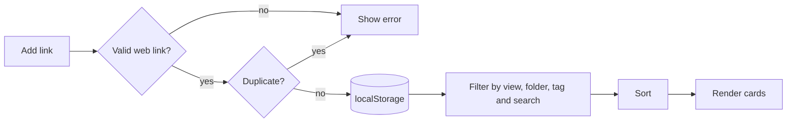

# 🔖 Markly

### Save it once. Find it in a second.

A private, fast bookmark manager with folders, tags, favorites, instant search and backup. It runs entirely in your browser.


[**Live Demo**](https://YOUR-USERNAME.github.io/markly) · [**Report a Bug**](../../issues) · [**Request a Feature**](../../issues)

</div>

---

## Table of Contents

- [Overview](#overview)
- [Features](#features)
- [Keyboard Shortcuts](#keyboard-shortcuts)
- [How It Works](#how-it-works)
- [Data Model](#data-model)
- [Backup and Import](#backup-and-import)
- [Getting Started](#getting-started)
- [Customize](#customize)
- [Security and Privacy](#security-and-privacy)
- [Test Checklist](#test-checklist)
- [Known Limitations](#known-limitations)
- [Roadmap](#roadmap)
- [Contributing](#contributing)
- [Author](#author)

## Overview

Browser bookmarks get messy. Markly gives you a clean library where every link has a title, a folder, tags and a note about why you saved it. Search covers all of that at once, so you can find a link by remembering any piece of it.

There is no account, no server and no tracking. Your bookmarks stay in your browser.

## Features

| Area | What you get |
|---|---|
| **Add and edit** | Link, optional title, folder, tags and notes. A blank title uses the site name |
| **Smart links** | Adds `https://` if missing, accepts only web links and blocks duplicates |
| **Folders** | Created as you type, with live counts in the sidebar |
| **Tags** | Comma separated, deduplicated and lowercased, with a clickable tag list |
| **Favorites** | Star any bookmark and filter to favorites |
| **Recently visited** | Opening a link records a visit, and a dedicated view lists the latest |
| **Search** | Instant, across title, link, notes, folder and tags |
| **Sorting** | Newest, oldest, A to Z and most visited |
| **Layouts** | Grid or list, remembered between visits |
| **Undo delete** | A five-second undo after removing a bookmark |
| **Backup** | Copy, download or paste JSON, and import from a file or text |
| **Themes** | Light and dark, following your device with a manual toggle |
| **Responsive** | The sidebar becomes a swipeable row on phones |
| **Accessible** | Labelled controls, visible focus rings, dialogs with keyboard support and reduced-motion support |

## Keyboard Shortcuts

| Key | Action |
|---|---|
| `/` | Jump to search |
| `n` | Add a new bookmark |
| `Esc` | Close a dialog |

## How It Works



**Link rules**

- Links without a scheme get `https://`.
- Only `http` and `https` links are accepted, so `javascript:` and other schemes are rejected.
- A link needs a dot in its hostname, so `localhost` and plain words are rejected.
- Duplicates are detected by host (ignoring `www.`), path (ignoring a trailing slash) and query.

**Avatars**: the site's favicon is not fetched, which keeps the app private and offline-friendly. Each bookmark gets a coloured letter tile generated from its domain.

## Data Model

Stored as a JSON list under the key `markly-v1`:

```json
{
  "id": "b1k9x2ab",
  "url": "https://developer.mozilla.org/",
  "title": "MDN Web Docs",
  "folder": "Learning",
  "tags": ["reference", "web"],
  "desc": "The go-to documentation for HTML, CSS and JavaScript.",
  "fav": true,
  "visits": 3,
  "added": 1766000000000,
  "last": 1766100000000
}
```

| Other keys | Purpose |
|---|---|
| `markly-theme` | Your light or dark choice |
| `markly-list` | Your grid or list preference |

The first visit loads five sample bookmarks so the app does not start empty. Delete them whenever you like.

## Backup and Import

Open **Backup** in the header.

| Button | What it does |
|---|---|
| **Copy** | Copies your full backup as JSON |
| **Download** | Saves `markly-backup.json` (works on the hosted site) |
| **Import text** | Reads the JSON in the box and adds new bookmarks |
| **Import file** | Reads a `.json` backup from your device |

Imports are validated and sanitised. Invalid links and duplicates are skipped, and the app reports how many bookmarks were added.

## Getting Started

```bash
git clone https://github.com/YOUR-USERNAME/markly.git
cd markly
open index.html          # or: npx serve .
```

No installs and no build step.

**Deploy for free**

| Platform | Steps |
|---|---|
| **GitHub Pages** | Settings → Pages → Deploy from `main` |
| **Netlify** | Drag and drop the folder |
| **Vercel** | Import the repository |

## Customize

- **Sample bookmarks**: edit the `SEED` array, or empty it to start blank.
- **Accent colour**: change `--ac` (and `--acs`) in the `:root` block.
- **Undo time**: change the `5000` milliseconds in `toast()`.
- **Storage key**: change `KEY` to keep separate libraries on one domain.

## Security and Privacy

- All data stays in your browser's `localStorage`. Nothing is sent to a server.
- Every value that is shown on the page is escaped, which protects against script injection from saved titles, notes and tags.
- External links open with `rel="noopener noreferrer"`.
- Clearing site data erases your bookmarks, so use **Backup** regularly.

## Test Checklist

- [ ] Adding `example.com/page` saves it as `https://example.com/page`
- [ ] `javascript:alert(1)`, `localhost` and plain words are rejected
- [ ] Adding the same link twice shows a duplicate message
- [ ] A blank title falls back to the site name
- [ ] Folders and tags appear in the sidebar with correct counts
- [ ] Clicking a tag or folder filters, and clicking it again clears the filter
- [ ] Search matches title, notes, tags and folder names
- [ ] Deleting shows Undo, and Undo restores the bookmark in the same position
- [ ] Opening a link increases its visit count and adds it to Recently visited
- [ ] Export, then import into an empty library, restores everything
- [ ] Refreshing keeps your data, theme and layout
- [ ] Keyboard shortcuts work and do not fire while typing

## Known Limitations

- Data is stored per browser and device. Use Backup to move it.
- Browser storage is limited to a few megabytes, which is plenty for thousands of links.
- Favicons and page titles are not fetched automatically.
- Bookmarks are not synced between devices.

## Roadmap

- [x] Folders, tags, favorites and search
- [x] Visit tracking and recently visited
- [x] Undo delete
- [x] Backup and import
- [x] Light and dark themes
- [ ] Import browser bookmark HTML exports
- [ ] Drag and drop between folders
- [ ] Bulk select and bulk tag
- [ ] Optional page title lookup
- [ ] Installable app (PWA) for offline use
- [ ] Optional sync through a backend

## Contributing

1. Fork the repository
2. Create a branch: `git checkout -b feature/your-idea`
3. Commit: `git commit -m "Add your idea"`
4. Push and open a pull request

## Author

**S.S. Manikanda Prabu**, B.Tech CSE, SRM Institute of Science and Technology, Ramapuram

[GitHub](https://github.com/YOUR-USERNAME) · [LinkedIn](https://linkedin.com/in/YOUR-PROFILE)

## License

Released under the MIT License.
